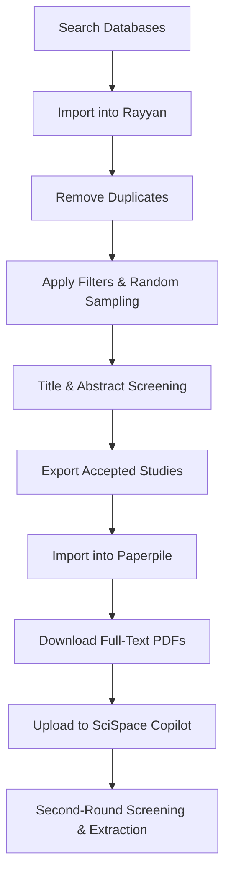

# Systematic Review Methodology

This repository documents a reproducible, AI/non-AI-assisted systematic review workflow using the following tools:

- 🧠 **Rayyan AI**: For duplicate removal, filtering, random sampling, and abstract/title screening
- 📄 **Paperpile** (or similar): For downloading and organizing full-text PDFs via university access, integrations, and online sources
- 🤖 **SciSpace Copilot**: For full-text screening, keyword searching, AI-based extraction, and PDF parsing

--- 

## Tools Overview

- **Rayyan AI**: [https://rayyan.ai](https://rayyan.ai)
- **Paperpile**: [https://paperpile.com](https://paperpile.com)
- **SciSpace Copilot**: [https://typeset.io](https://typeset.io)

---

## Workflow Diagram



--- 

## Structure

```plaintext
systematic-review-methodology-ai/
├── README.md
├── PRISMA-Checklist.md
├── Rayyan-AI.md
├── Paperpile-Workflow.md
├── SciSpace-Extraction.md
└── Data/
    ├── inclusion_criteria.txt
    ├── exclusion_criteria.txt
    └── prisma_diagram.png
```
---

## New Module: VOSviewer Bibliometrics

We added a fourth tool — **VOSviewer** — to generate topic maps and collaboration networks from your screened corpus. Start here: **[VOSviewer-Bibliometrics.md](./VOSviewer-Bibliometrics.md)** and copy the thesaurus/stoplist templates from the repository root:
- `templates_vosviewer_thesaurus.txt`
- `templates_vosviewer_stoplist.csv`

Recommended folder for outputs: `data/vosviewer/` (see suggested structure in the VOSviewer guide).
