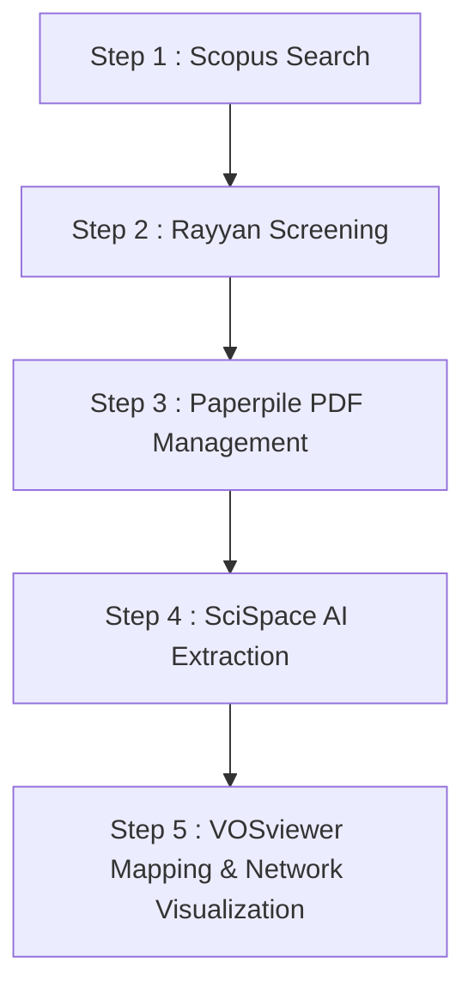

# 🧩 Systematic Review Methodology Using AI & Bibliometric Tools

This repository provides a **reproducible, AI-assisted workflow** for conducting systematic reviews and bibliometric analyses.  
It integrates automated literature screening, full-text analysis, and visualization across five complementary tools.

---

## 🧠 Overview of Tools

| Step | Tool | Function | Key Outputs |
|------|------|-----------|--------------|
| **Step 1** | 🔍 **Scopus Search & Analysis** | Query literature databases, export (CSV/RIS/BibTeX), and generate local analytics | Yearly trends, top authors, affiliations, countries, and keywords |
| **Step 2** | 🧠 **Rayyan AI** | AI-assisted title and abstract screening with duplicate removal and conflict resolution | Cleaned and screened reference set (CSV, Excel, RIS) |
| **Step 3** | 📄 **Paperpile** | Reference and PDF management via university access and Google Drive integration | Organized full-text PDF library |
| **Step 4** | 🤖 **SciSpace Copilot** | AI-driven PDF interrogation for extracting key methods, results, and study metadata | Structured tables and text summaries |
| **Step 5** | 📊 **VOSviewer** | Bibliometric mapping of keywords, citations, and co-authorship networks | Topic maps, collaboration clusters, and overlay visualizations |

---

## ⚙️ Workflow Overview



---

## 📂 Repository Structure

```plaintext
Systematic-Review-Toolkit/
├── data/
│   ├── exports/               # Raw Scopus/WoS exports (CSV, RIS, BibTeX)
│   ├── scopus_analysis/       # Summaries and charts from scopus_summary_analysis.py
│   ├── vosviewer/             # Network and map exports from VOSviewer
│   └── thesaurus/             # Custom thesaurus and stoplists
├── tools/
│   └── scopus_summary_analysis.py
├── Step1-Scopus-Search-and-Analysis.md
├── Step2-Rayyan-AI.md
├── Step3-Paperpile-Workflow.md
├── Step4-SciSpace-Extraction.md
├── Step5-VOSviewer-Bibliometrics.md
└── readme.md
```

---

## 🚀 How to Use the Workflow

### Step 1 – Scopus Search & Analysis  
Perform structured Boolean searches, export records, and summarise trends.  
👉 [Step1-Scopus-Search-and-Analysis.md](Step1-Scopus-Search-and-Analysis.md)

### Step 2 – Rayyan AI Screening  
Import exported records into Rayyan for AI-assisted inclusion/exclusion and conflict resolution.  
👉 [Step2-Rayyan-AI.md](./Step2-Rayyan-AI.md)

### Step 3 – Paperpile PDF Management  
Manage and sync full-text PDFs through Google Drive and institutional access.  
👉 [Step3-Paperpile-Workflow.md](./Step3-Paperpile-Workflow.md)

### Step 4 – SciSpace Extraction  
Interact with PDFs using AI to extract key methods, results, and evidence.  
👉 [Step4-SciSpace-Extraction.md](./Step4-SciSpace-Extraction.md)

### Step 5 – VOSviewer Bibliometrics  
Visualise bibliometric relationships — co-authorship, keyword co-occurrence, and citation networks.  
👉 [Step5-VOSviewer-Bibliometrics.md](./Step5-VOSviewer-Bibliometrics.md)

---

## 🔍 Recommended Reading Order

1. [Step1-Scopus-Search-and-Analysis.md](./Step1-Scopus-Search-and-Analysis.md)  
2. [Step2-Rayyan-AI.md](./Step2-Rayyan-AI.md)  
3. [Step3-Paperpile-Workflow.md](./Step3-Paperpile-Workflow.md)  
4. [Step4-SciSpace-Extraction.md](./Step4-SciSpace-Extraction.md)  
5. [Step5-VOSviewer-Bibliometrics.md](./Step5-VOSviewer-Bibliometrics.md)

---

## 🧾 Citation & Acknowledgment

> Amarasingam, N. (2025). *Systematic Review Toolkit: AI-assisted Literature Screening and Bibliometric Analysis Workflow.*  
> University of Wollongong. GitHub Repository: [Systematic-Review-Toolkit](https://github.com/narmilan/Systematic-Review-Toolkit)

---

© 2025 Narmilan Amarasingam — University of Wollongong | Licensed under MIT
