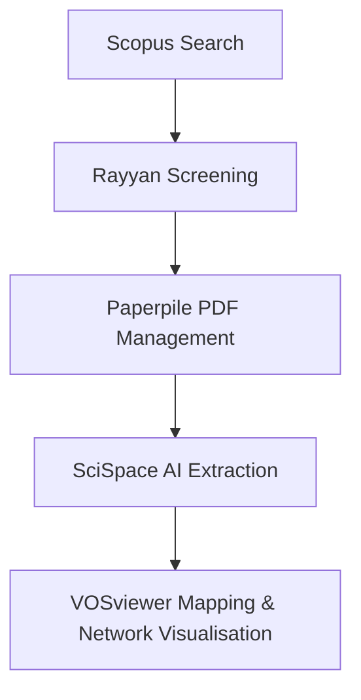

## 🧩 Systematic Review Methodology Using AI & Bibliometric Tools

This repository provides a **reproducible, AI-assisted workflow** for conducting systematic reviews and bibliometric analyses.  
It integrates automated literature screening, full-text analysis, and visualisation across five complementary tools.

---

### 🧠 Overview of Tools

| Tool | Function | Key Outputs |
|------|-----------|--------------|
| 🔍 **Scopus Search & Analysis** | Query literature databases, export (CSV/RIS/BibTeX), and generate local analytics | Yearly trends, top authors, affiliations, countries, and keywords |
| 🧠 **Rayyan AI** | AI-assisted title and abstract screening with duplicate removal and conflict resolution | Cleaned and screened reference set (CSV, Excel, RIS) |
| 📄 **Paperpile** | Reference and PDF management via university access and Google Drive integration | Organised full-text PDF library |
| 🤖 **SciSpace Copilot** | AI-driven PDF interrogation for extracting key methods, results, and study metadata | Structured tables and text summaries |
| 📊 **VOSviewer** | Bibliometric mapping of keywords, citations, and co-authorship networks | Topic maps, collaboration clusters, and overlay visualisations |

---

### ⚙️ Workflow Overview

This workflow ensures transparency and reproducibility from literature search to network analysis:



Each tool contributes a unique stage in the systematic review process:

1. **Scopus Search & Analysis** — Initial data gathering and descriptive analytics.  
2. **Rayyan AI** — Title/abstract screening and inclusion filtering.  
3. **Paperpile** — Centralised PDF management for full-text access.  
4. **SciSpace Copilot** — Full-text understanding and result extraction.  
5. **VOSviewer** — Advanced bibliometric visualisation and research landscape mapping.

---

### 📂 Repository Structure

```plaintext
├── Scopus-Search-and-Analysis.md
├── Rayyan-AI.md
├── Paperpile-Workflow.md
├── SciSpace-Extraction.md
├── VOSviewer-Bibliometrics.md
└── readme.md
```

---

### 🚀 How to Get Started

#### Step 1. Conduct a Literature Search
Use **Scopus Search & Analysis** to perform structured Boolean queries, export references, and generate descriptive statistics.  
👉 [Guide → Scopus-Search-and-Analysis.md](./Step1-Scopus-Search-and-Analysis.md)

#### Step 2. Screen Titles & Abstracts
Import exported records into **Rayyan AI** to remove duplicates, tag inclusion/exclusion criteria, and resolve reviewer conflicts.  
👉 [Guide → Rayyan-AI.md](./Step2-Rayyan-AI.md)

#### Step 3. Manage Full-Text PDFs
Load screened references into **Paperpile**, link with institutional access, and download full-texts to Google Drive.  
👉 [Guide → Paperpile-Workflow.md](./Step3-Paperpile-Workflow.md)

#### Step 4. Extract Key Insights
Upload full-text PDFs to **SciSpace Copilot** to ask AI-driven questions and extract tables of methodologies, results, or findings.  
👉 [Guide → SciSpace-Extraction.md](./Step4-SciSpace-Extraction.md)

#### Step 5. Visualise Bibliometric Networks
Use **VOSviewer** to build co-authorship, co-occurrence, and citation maps from Scopus/WoS exports or screened datasets.  
👉 [Guide → VOSviewer-Bibliometrics.md](./Step5-VOSviewer-Bibliometrics.md)

---

### 📘 Example Applications

- Meta-analysis of research trends in **polar remote sensing** or **precision agriculture**.  
- Identification of **emerging keywords** and **collaborative clusters**.  
- Comparison of **topic evolution** over time using overlay maps.  
- Extraction of **methods and datasets** from full-text articles for quantitative synthesis.

---

### 🧩 Integration Pathway

| Phase | Tool | Output Type | Next Step |
|-------|------|--------------|------------|
| 1. Literature Retrieval | Scopus Search & Analysis | CSV / RIS / BibTeX | Import to Rayyan |
| 2. Screening | Rayyan AI | Screened CSV / RIS | Import to Paperpile |
| 3. Full-text Access | Paperpile | PDF set | Upload to SciSpace |
| 4. AI Extraction | SciSpace Copilot | Structured text/tables | Export for synthesis |
| 5. Network Mapping | VOSviewer | Maps / Networks | Integrate into figures & results |

---

### 🔍 Recommended Reading Order

1. [Scopus-Search-and-Analysis.md](./Step1-Scopus-Search-and-Analysis.md)  
2. [Rayyan-AI.md](./Step2-Rayyan-AI.md)  
3. [Paperpile-Workflow.md](./Step3-Paperpile-Workflow.md)  
4. [SciSpace-Extraction.md](./Step4-SciSpace-Extraction.md)  
5. [VOSviewer-Bibliometrics.md](./Step5-VOSviewer-Bibliometrics.md)

---

### 🧾 Citation & Acknowledgment

If you use or adapt this workflow in your research, please cite it as:

> Amarasingam, N. (2025). *Systematic Review Toolkit: AI-assisted Literature Screening and Bibliometric Analysis Workflow.* University of Wollongong.  
> GitHub Repository: [Systematic-Review-Toolkit](https://github.com/Narmilan-A/Systematic-Review-Toolkit)

---

© 2025 Narmilan Amarasingam — University of Wollongong |
